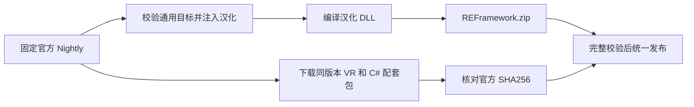
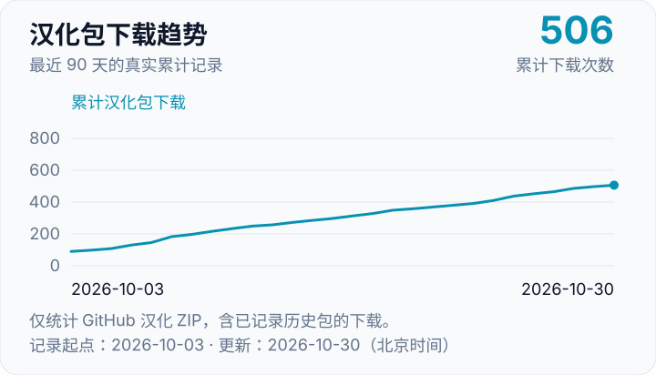

# REFramework Chinese Builder

为 REFramework 注入中文文本，跟随官方 Nightly（开发版）自动构建和发布，供原项目支持的多款 RE Engine 游戏使用。**汉化核心由对应官方源码重新编译，可选配套包与官方同版本同步。**

**[下载最新汉化包](https://github.com/xuyuhong996/reframework-chinese-builder/releases/latest)** · [查看历史版本](https://github.com/xuyuhong996/reframework-chinese-builder/releases) · [反馈未汉化内容](https://github.com/xuyuhong996/reframework-chinese-builder/issues)

整理词库、适配更新和维护自动构建都需要投入时间。如果这个项目帮到了你，欢迎点个 Star（收藏支持），也请把项目链接分享给身边的玩家、朋友或游戏社区。**制作不易，好东西值得让更多人知道。** 你的分享与反馈，就是项目继续维护的动力。

## 原项目与作者

REFramework 的原作者项目为 [praydog/REFramework](https://github.com/praydog/REFramework)。本仓库的自动构建会获取对应官方 Nightly 的源码提交，注入中文文本后生成发布包。

本仓库是独立的汉化构建与发布项目，**不是 REFramework 原作者的官方仓库，也不代表原作者提供支持或兼容性保证**。REFramework 本体的源码、更新与技术问题请以原作者仓库为准。

## 支持的游戏与汉化范围

当前官方 Nightly 已改用**通用 DLL**，由官方代码在运行时识别游戏。原先按游戏提供的 `RE2.zip`、`DMC5.zip`、`MHWILDS.zip` 等独立包已被 `REFramework.zip` 取代，详见[官方迁移说明](https://github.com/praydog/REFramework-nightly/releases/tag/nightly-01433-d4611aef1d63effd3a736bdf9404ea702428017d)。

本项目保留官方通用构建和游戏识别，支持范围跟随对应官方源码，包括《怪物猎人：荒野》《怪物猎人：崛起》、生化危机系列、鬼泣5、街头霸王6、龙之信条2等。[官方游戏清单](https://github.com/praydog/REFramework#supported-games)及每次构建的 `build-info.json` 可查看具体范围。

汉化对象是 **REFramework 及词库已收录的 Mod 界面文字**，不包括游戏剧情；词库外的文本保留原文。作者已在《怪物猎人：荒野》中使用过，**其他游戏尚未逐一实测**，自动编译通过不代表所有游戏已验证可用。

**当前官方通用版不支持 RE2、RE3、RE7 的非光追旧版**，不能代替旧 `TDB66` / `TDB67` / `TDB49` 专用分支。

## 提交未汉化 Mod

如果你在官方支持的游戏中发现仍未汉化的 Mod，欢迎在 Issues 中提供**游戏名称与版本、汉化包编号、Mod 发布链接，以及未汉化界面的位置或截图**。我会根据实际情况补充词库；是否能够适配取决于 Mod 的实现方式与可取得的文本内容。

## 获取成品

请从 **[最新汉化包](https://github.com/xuyuhong996/reframework-chinese-builder/releases/latest)** 页面按用途下载：

| 附件 | 用途 | 是否必需 |
| --- | --- | --- |
| `REFramework.zip` | 注入汉化库后重新编译的核心 DLL，附游戏清单和安装说明 | 普通使用下载此包即可 |
| `VR.zip` | 同版本官方 VR（虚拟现实）配套文件，保持官方内容 | 仅 VR 用户需要 |
| `csharp-api.zip` | 同版本官方 C# 插件框架，保持官方内容 | 仅运行 C# 插件时需要，普通 Lua 脚本无需下载 |
| `SHA256SUMS.txt` | 发布附件的 SHA256 校验值 | 按需核对 |
| `bundle-info.json` | 官方来源、版本和各附件是否经过汉化的记录 | 按需查看 |

**非 VR 用户只需把主包内的 `dinput8.dll` 放到游戏程序所在目录**，保留已有的 `reframework` 脚本目录和配置。安装说明、构建信息、许可证和打赏图片无需复制到游戏目录。VR 用户按[官方 VR 指引](https://github.com/praydog/REFramework/wiki/VR-Troubleshooting)安装同版本配套文件，并保留本项目的汉化 DLL。

每次发布固定使用同一个官方 Nightly，配套包下载后会核对官方 SHA256，避免版本混用或文件损坏。历史版本的 `REFramework-编号.zip` 仍保留，旧发布不修改。

最新版本请以页面的 **Latest（最新）** 标记为准，不要只看历史发布列表的第一条。

## 自动构建

GitHub Actions（自动工作流）计划每 15 分钟检查一次 [官方 Nightly 发布](https://github.com/praydog/REFramework-nightly/releases/latest)。发现新的 Nightly 标签后，使用 Windows Server 2022 和 Visual Studio 2022 构建环境拉取源码、注入汉化并创建 ZIP 发布。GitHub 的定时任务可能排队延迟，实际执行时间以 [运行记录](https://github.com/xuyuhong996/reframework-chinese-builder/actions/workflows/build-release.yml) 为准。

官方没有发布新版本且对应附件已完整同步时，检查成功后会跳过打包。汉化词库、构建或打包逻辑合并更新后，也会自动重新构建。合并请求仅编译、校验并保存验证产物，不创建正式发布。手动运行时勾选“仅检查版本，不重新打包”，可以直接核对版本而不进行编译。

自动构建会固定使用本次检测到的 Nightly 对应源码提交，并将同一编号用于包名和发布记录，避免构建期间官方更新导致编号与源码不一致。



发布标题使用官方 **Nightly 编号**：例如官方 `nightly-01433-…` 对应 `REFramework-汉化-01433`，附件沿用官方的用途命名。官方主仓库的稳定版属于不同发布系列，不能直接用来判断开发版汉化是否落后。

## 打赏支持

如果这个项目对你有帮助，欢迎通过微信打赏支持维护。


## 本地手动构建

```powershell
python build_chinese.py
```

## 下载趋势



每天自动记录 GitHub 汉化主包的累计下载次数，显示最近 90 天的采样趋势；不包含 VR / C# 配套包、校验文件或网盘下载，也不代表独立用户数。只保留真实采样，过去每天的下载量无法补回。

统计保留已记录历史包的最后下载计数，即使旧附件被删除也不会丢失这些记录。日期按北京时间显示，完整记录可查看 [下载数据](assets/download-history.json)。
