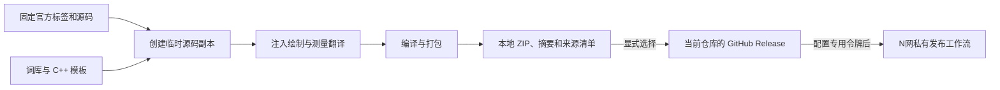

# 代码结构

这是一个构建工具：一个入口、按职责划分的模块，以及可直接阅读的 C++ 模板。运行时没有模型调用、翻译服务或额外后台进程。

| 位置 | 职责 |
| --- | --- |
| `build_chinese.py` | 命令行入口 |
| `scripts/build_pipeline.py` | 串联构建步骤，默认不发布 |
| `scripts/upstream_release.py` | 一次确定官方 Nightly 标签、编号和源码提交 |
| `scripts/source_checkout.py` | 检出指定源码，在临时副本构建，保留上游本地修改 |
| `scripts/translation_assets.py` | 读取词库并填充 C++ 模板 |
| `templates/Translation.cpp` | 精确匹配、哈希兼容、外部词库和有长度限制的文本翻译 |
| `scripts/imgui_patches.py` | 在文字测量和绘制处注入翻译，控件标识仍用原文 |
| `scripts/cmake_patches.py` | 集中维护上游构建适配 |
| `scripts/release_artifacts.py` | 打包、摘要、来源清单及显式 GitHub 发布 |
| `scripts/repository_identity.py` | 从当前 `origin` 识别构建和发布归属 |
| `scripts/nexus_dispatch.py` | 将已发布包交给单独配置的 N网仓库 |

翻译发生在格式化完成后的文字测量与绘制阶段；窗口名、控件名称、`GetID` 和 `PushID` 保持上游行为。文本片段携带结束位置，不依赖片段后面存在零字符。词库没匹配时原文返回。

临时源码和编译目录由本次构建自行创建并在结束时回收；源码缓存与输出包保留。发布包包含官方 Nightly 标签、源码提交、构建仓库和 DLL 摘要，便于追查来源。这里只保证来源可追溯，不宣称二进制逐字节可重复。

N网派发与编译分开。新发布说明包含待派发标记，失败时保留；后续检查重试前先查询是否已有对应工作流，避免响应丢失导致重复交接。交接成功不等于 N网上传成功，上传结果仍以私有仓库工作流为准。历史发布没有待办标记时不自动重放。
